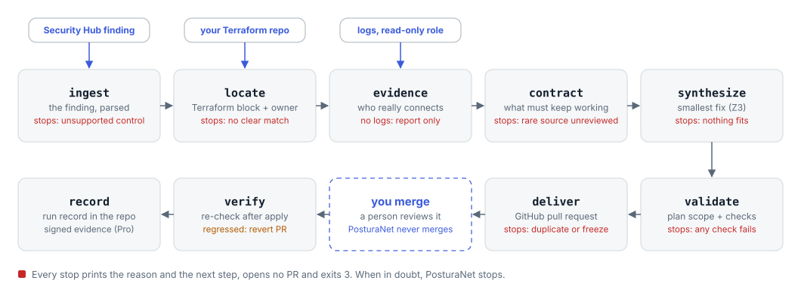
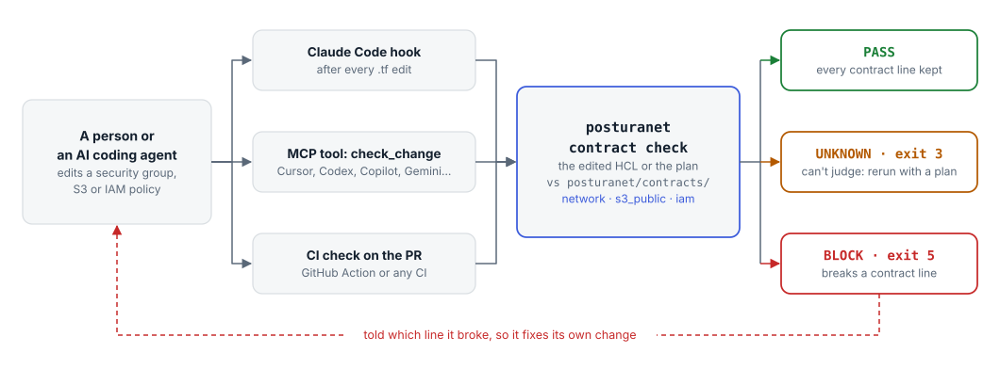
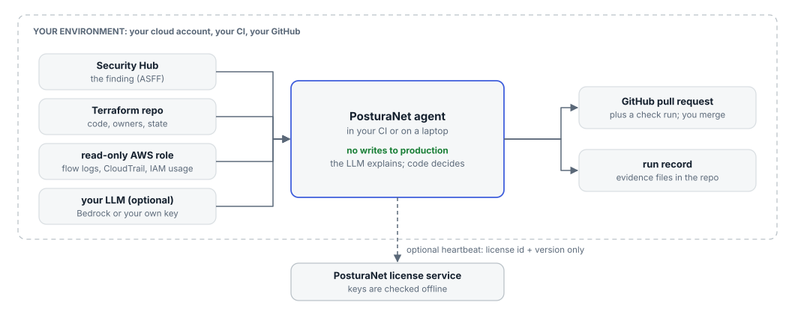

# PosturaNet

**Fixes cloud security issues without breaking prod.**

PosturaNet is a source-available remediation agent for AWS + Terraform. It takes a security finding, locates the owning Terraform and team, learns what actually uses the resource from flow logs and CloudTrail, records that as a *behavior contract*, and opens a pull request with the smallest fix that keeps every observed behavior working. It runs in your CI with a read-only role and never changes production.

It also checks every security group, S3 and IAM policy change, written by a person or an AI agent, against those contracts before it merges: a `PosturaNet contract` check on PRs, a step in any CI, a Claude Code plugin, and MCP setups for Cursor, Codex, Copilot, Gemini, Windsurf, Cline, Kiro, Continue, Zed and Goose. See [integrations/](integrations/README.md).

> Status: early access (0.2.0). Security groups, S3 public access, IAM least privilege and 74 settings controls. Findings from Security Hub, Prowler, Checkov or Trivy.

## How it works

**From finding to pull request.** Nine stages, each a plain function. Any stage that lacks what it needs stops with the reason and the next step, and no PR is opened:



**Every later change is checked.** The contract records what must keep working. A change by a person or an AI coding agent is checked against it in the agent, over MCP, or in CI:



**It runs where your code runs.** A read-only role, your own LLM if you use one, and no customer data sent anywhere:



Diagrams are drawn by `python docs/media/diagrams.py`; the full design is in [docs/02_ARCHITECTURE_AND_DATA.md](docs/02_ARCHITECTURE_AND_DATA.md).

## Install
```bash
pip install posturanet            # add [mcp] for the MCP server: pip install "posturanet[mcp]"
posturanet init                   # prints the read-only IAM policy PosturaNet needs
```
In Claude Code, add the plugin (skill, MCP server and a hook that checks every `.tf` edit):
```text
/plugin marketplace add Mihirajmera/posturanet
/plugin install posturanet@posturanet
```
Cursor, Codex, Copilot, Gemini, Windsurf, Cline, Kiro, Continue, Zed, Goose and other MCP clients: see [integrations/agents/](integrations/agents/README.md).
Python 3.11+. If your shell can't find `posturanet` (common with the Microsoft Store Python on Windows), run `python -m posturanet` instead. The GitHub Action is `Mihirajmera/posturanet/action@v0.2.0`; see [integrations/](integrations/README.md).

## See it

Recorded from real runs against the synthetic fixtures in `tests/fixtures/` (regenerate with `python docs/media/make.py`).

**A security group with SSH open to the internet.** PosturaNet reads 89 days of flow logs, keeps the four sources that really connect, drops a one-off scanner, flags the outside partner for review, and proposes the smallest change:


**An IAM policy with `ec2:*`.** Shrunk to the three actions IAM's last-accessed data shows in use, with every unknown spelled out:


**A person or an AI agent puts the wildcard back.** The contract check blocks the edit and says which contract line it breaks:


**Inside a coding agent.** With the Claude Code plugin, this is what Claude is told right after its edit, so it fixes its own change before going on. Other agents get the same result from the MCP tool `check_change` ([setup per agent](integrations/agents/README.md)):


## From your scanner
PosturaNet doesn't detect; it fixes what your scanner already found. It reads findings from:

| Scanner | Output to pass | Controls PosturaNet can fix from it |
|---|---|---|
| AWS Security Hub | ASFF JSON, or OCSF from `aws securityhub get-findings-v2` / EventBridge | all 88 |
| Security Hub remediation plans | `posturanet findings pull-plans` (read-only) | the plan's linked controls PosturaNet fixes, as one PR per plan |
| Prowler | `prowler aws --output-formats json-ocsf` (or its ASFF output) | 72, from Prowler's own mapping to Security Hub controls |
| Checkov | `checkov -d . -o json` | 52, from 56 Checkov checks |
| Trivy | `trivy config -f json .` | 31, from 36 Trivy checks |

A scan holds many findings. List the ones PosturaNet can fix, write one file each, then fix one:
```bash
posturanet findings list scan.json            # --all also shows the rest and why
posturanet findings split scan.json --out findings/
posturanet fix findings/EC2.13-sg-0a91f3c2.json --dry-run --repo infra/
```
A Security Hub remediation plan targets one resource and groups the exposures one fix would close. PosturaNet reads the controls those exposures link, fixes the ones it supports on that resource as one change (for example `RDS.2+RDS.8`: no public access and deletion protection), and opens one PR for the plan. AWS's own guidance text is shown to you but never used to write the change.

Checkov and Trivy read your code, so their findings name a Terraform address. PosturaNet finds the deployed resource for that address in the Terraform state; a resource that isn't applied yet stops with a clear reason. Each Checkov and Trivy check was mapped by hand after reading the check's source, and a check that isn't mapped is listed as unsupported, never guessed (`src/posturanet/ingest/iac_checks.json`).

## Try it (offline, no AWS)
From a clone of this repo:
```bash
pip install -e ".[dev]"
posturanet fix tests/fixtures/findings/sg_ssh_open.json --dry-run \
  --repo tests/fixtures/tf/basic --evidence-file tests/fixtures/flows/bastion_90d.json
```
This reads a synthetic finding, finds the Terraform block and its owner, builds a behavior contract from 89 days of synthetic flow logs, computes the smallest rule set with Z3, and prints the diff. Nothing is written.

With a read-only role: drop `--dry-run` to read flow logs and run `terraform plan`, then add `--open-pr`. Before changing a security group, S3 bucket policy or IAM policy, run `posturanet contract check --plan plan.json`, or `--source` for an offline check of the edited HCL (exit 5 means BLOCK).

## What it fixes
- **Security group ingress** (EC2.13, 14, 18, 19, 53, 54): replaces open rules with the sources seen in VPC flow logs, checked with Z3 against a behavior contract.
- **74 more controls** as attribute fixes: settings like RDS deletion protection and backups, DynamoDB point-in-time recovery, KMS key rotation, CloudTrail log validation, OpenSearch encryption and the IAM password policy. No evidence needed; same plan-scope checks, so a setting that would replace the resource stops instead. The ones that can affect a client (public access on RDS, Redshift and EKS, public IPs on launch templates and ECS services, IMDSv2, ECR tag immutability, S3 ACLs, KMS on S3 and SNS) are marked `risk: medium` and say what to check before merging.

```bash
posturanet fixes list               # every control and what it changes
posturanet fixes show RDS.8         # one control in detail
posturanet fix tests/fixtures/findings/rds_deletion_protection.json --dry-run --repo tests/fixtures/tf/config
```

## Project docs
| Doc | Purpose |
|---|---|
| [docs/01_PRD.md](docs/01_PRD.md) | Product requirements: what we build, with FR/NFR IDs |
| [docs/02_ARCHITECTURE_AND_DATA.md](docs/02_ARCHITECTURE_AND_DATA.md) | Architecture, data models, schemas, queries |
| [AGENTS.md](AGENTS.md) | Rules for AI coding agents, and for PosturaNet's own runtime agent |
| [docs/04_DESIGN_SYSTEM.md](docs/04_DESIGN_SYSTEM.md) | CLI, PR, check-run and brand design system |

## License
[Functional Source License 1.1, Apache 2.0 future license](LICENSE.md) (`FSL-1.1-ALv2`).

- **You can** use PosturaNet for free in your own company, read the code, change it and run it in your CI, including for clients if you provide services.
- **You can't** offer it, or a product built from it, as a competing commercial product or service.
- **After two years** each release becomes Apache 2.0, with no restrictions.

"PosturaNet" is a trademark: forks must use another name. Paid features ship separately in `posturanet-pro`.
