# PosturaNet

**Fixes cloud security issues without breaking prod.**

PosturaNet is a source-available remediation agent for AWS + Terraform. It takes a security finding, locates the owning Terraform and team, learns what actually uses the resource from flow logs and CloudTrail, records that as a *behavior contract*, and opens a pull request with the smallest fix that keeps every observed behavior working. It runs in your CI with a read-only role and never changes production.

It also checks every security group, S3 and IAM policy change, written by a person or an AI agent, against those contracts before it merges: a `PosturaNet contract` check on PRs, a step in any CI, a Claude Code plugin, and MCP setups for Cursor, Codex, Copilot, Gemini, Windsurf, Cline, Kiro, Continue, Zed and Goose. See [integrations/](integrations/README.md).

> Status: early access. PyPI 0.1.0 covers security groups; `main` adds S3 public access and IAM least privilege.

## Install
```bash
pip install posturanet            # add [mcp] for the MCP server: pip install "posturanet[mcp]"
posturanet init                   # prints the read-only IAM policy PosturaNet needs
```
In Claude Code, add the plugin (skill, MCP server and a hook that checks every `.tf` edit):
```text
/plugin marketplace add Mihirajmera/posturanet
/plugin install posturanet@posturanet
```
Cursor, Codex, Copilot, Gemini, Windsurf, Cline, Kiro, Continue, Zed, Goose and other MCP clients: see [integrations/agents/](integrations/agents/README.md).
Python 3.11+. If your shell can't find `posturanet` (common with the Microsoft Store Python on Windows), run `python -m posturanet` instead. The GitHub Action is `Mihirajmera/posturanet/action@v0.1.0`; see [integrations/](integrations/README.md).

## See it

Recorded from real runs against the synthetic fixtures in `tests/fixtures/` (regenerate with `python docs/media/make.py`).

**A security group with SSH open to the internet.** PosturaNet reads 89 days of flow logs, keeps the four sources that really connect, drops a one-off scanner, flags the outside partner for review, and proposes the smallest change:


**An IAM policy with `ec2:*`.** Shrunk to the three actions IAM's last-accessed data shows in use, with every unknown spelled out:



**A person or an AI agent puts the wildcard back.** The contract check blocks the edit and says which contract line it breaks:



**Inside a coding agent.** With the Claude Code plugin, this is what Claude is told right after its edit, so it fixes its own change before going on. Other agents get the same result from the MCP tool `check_change` ([setup per agent](integrations/agents/README.md)):



## Try it (offline, no AWS)
From a clone of this repo:
```bash
pip install -e ".[dev]"
posturanet fix tests/fixtures/findings/sg_ssh_open.json --dry-run \
  --repo tests/fixtures/tf/basic --evidence-file tests/fixtures/flows/bastion_90d.json
```
This reads a synthetic finding, finds the Terraform block and its owner, builds a behavior contract from 89 days of synthetic flow logs, computes the smallest rule set with Z3, and prints the diff. Nothing is written.

With a read-only role: drop `--dry-run` to read flow logs and run `terraform plan`, then add `--open-pr`. Before changing a security group, S3 bucket policy or IAM policy, run `posturanet contract check --plan plan.json`, or `--source` for an offline check of the edited HCL (exit 5 means BLOCK).

## What it fixes
- **Security group ingress** (EC2.13, 14, 18, 19, 53, 54): replaces open rules with the sources seen in VPC flow logs, checked with Z3 against a behavior contract.
- **52 more controls** as attribute fixes: settings that remove no access, like RDS deletion protection, DynamoDB point-in-time recovery, KMS key rotation, CloudTrail log validation and the IAM password policy. No evidence needed; same plan-scope checks.

```bash
posturanet fixes list               # every control and what it changes
posturanet fixes show RDS.8         # one control in detail
posturanet fix tests/fixtures/findings/rds_deletion_protection.json --dry-run --repo tests/fixtures/tf/config
```

## Project docs
| Doc | Purpose |
|---|---|
| [docs/01_PRD.md](docs/01_PRD.md) | Product requirements: what we build, with FR/NFR IDs |
| [docs/02_ARCHITECTURE_AND_DATA.md](docs/02_ARCHITECTURE_AND_DATA.md) | Architecture, data models, schemas, queries |
| [AGENTS.md](AGENTS.md) | Rules for AI coding agents, and for PosturaNet's own runtime agent |
| [docs/04_DESIGN_SYSTEM.md](docs/04_DESIGN_SYSTEM.md) | CLI, PR, check-run and brand design system |

## License
[Functional Source License 1.1, Apache 2.0 future license](LICENSE.md) (`FSL-1.1-ALv2`).

- **You can** use PosturaNet for free in your own company, read the code, change it and run it in your CI, including for clients if you provide services.
- **You can't** offer it, or a product built from it, as a competing commercial product or service.
- **After two years** each release becomes Apache 2.0, with no restrictions.

"PosturaNet" is a trademark: forks must use another name. Paid features ship separately in `posturanet-pro`.
