# PosturaNet

**Fixes cloud security issues without breaking prod.**

PosturaNet is a source-available remediation agent for AWS + Terraform. It takes a security finding, locates the owning Terraform and team, learns what actually uses the resource from flow logs and CloudTrail, records that as a *behavior contract*, and opens a pull request with the smallest fix that keeps every observed behavior working. It runs in your CI with a read-only role and never changes production.

It also checks every security group, S3 and IAM policy change, written by a person or an AI agent, against those contracts before it merges: a `PosturaNet contract` check on PRs, a step in any CI, a Claude Code plugin, and MCP setups for Cursor, Codex, Copilot, Gemini, Windsurf, Cline, Kiro, Continue, Zed and Goose.

> Status: early access. 0.3.0 is on PyPI: `connect`, outcomes, exceptions, runbooks and approval at the terminal are new.
>
> 88 controls: security groups, S3 public access and IAM least privilege from usage evidence, plus 74 settings controls. Findings from Security Hub, Prowler, Checkov or Trivy.



## Get started

Each step has a command you can copy as written. Every command also prints its own examples: `posturanet <command> --help`.

### 1. Install
```bash
pip install posturanet            # add the MCP server for coding agents: pip install "posturanet[mcp]"
posturanet                        # every command, with an example
```
Python 3.11+. If your shell can't find `posturanet` (common with the Microsoft Store Python on Windows), run `python -m posturanet` instead.

### 2. Give it a read-only role
```bash
posturanet init > policy.json     # the read-only IAM policy PosturaNet needs; attach it to a role
```
PosturaNet only reads: flow logs, CloudTrail, IAM last-accessed data, S3 settings and access logs, and Terraform state. It never calls a mutating AWS API, and a person merges every PR.

### 3. Connect your scanner, coding agent and CI
```bash
posturanet connect                # everything PosturaNet works with
posturanet connect prowler        # the exact commands for one of them
posturanet connect cursor --write --repo .    # add the MCP server and rule to this repo
posturanet connect github --write --repo .    # add the PR check workflow
```
`--write` never overwrites a file you already have, and adds to an existing `AGENTS.md` instead of replacing it.



### 4. See what your findings end in
```bash
prowler aws --output-formats json-ocsf --output-directory prowler-out/
posturanet findings list prowler-out/<file>.ocsf.json --all
```
Every failed finding gets an outcome: `fix` (PosturaNet opens a PR), `runbook` (steps for a person, such as root MFA), `exception` (a risk your team accepted) or `none` yet. The top line shows your coverage.



Accepted a risk? Put it in `.posturanet/exceptions.yaml` with an owner and an expiry date. When it expires, the finding comes back.
```yaml
exceptions:
  - control: S3.8
    resource: acme-assets          # leave out to cover every resource for this control
    owner: web-team
    reason: public website bucket behind CloudFront
    expires: 2027-03-31
```
For a runbook: `posturanet fixes show IAM.6` prints the steps.

### 5. Fix one
```bash
posturanet findings split prowler-out/<file>.ocsf.json --out findings/   # one file per finding
posturanet fix findings/EC2.13-sg-0a91f3c2.json --dry-run --repo infra/  # see the fix; no AWS, writes nothing
posturanet fix findings/EC2.13-sg-0a91f3c2.json --repo infra/            # read evidence, run terraform plan
posturanet fix findings/EC2.13-sg-0a91f3c2.json --repo infra/ --open-pr  # open the PR when every check passes
```
If anything is missing (no evidence, an unclear owner, a check that fails), PosturaNet stops, says why and what to do next, and opens no PR.

**A security group with SSH open to the internet.** PosturaNet reads 89 days of flow logs, keeps the four sources that really connect, drops a one-off scanner, flags the outside partner for review, and proposes the smallest change:


**An IAM policy with `ec2:*`.** Shrunk to the three actions IAM's last-accessed data shows in use, with every unknown spelled out:


### 6. Approve what the evidence can't show
Some things only a person can confirm. For example, IAM doesn't record S3 object reads, so PosturaNet can't tell whether `s3:GetObject` is used. When you run `fix` at a terminal, it asks you about each item and shows the before and after. Only then does it ask `Approve this change?`. Your answers go into the contract and the PR says who approved it. Nothing is ever asked in CI, pipes, JSON output or agent hooks.



### 7. Keep it fixed
```bash
posturanet contract check --source --repo infra/                 # check an edit against the contracts (exit 5 = BLOCK)
terraform show -json plan.out > plan.json && posturanet contract check --plan plan.json   # the same in CI, from a plan
posturanet verify owner/repo#123 --repo infra/                   # after merge: did the fix hold?
```
**A person or an AI agent puts the wildcard back.** The contract check blocks the edit and says which contract line it breaks:


**Inside a coding agent.** With the Claude Code plugin, this is what Claude is told right after its edit, so it fixes its own change before going on. Other agents get the same result from the MCP tool `check_change`:


In Claude Code, add the plugin (skill, MCP server and a hook that checks every `.tf` edit):
```text
/plugin marketplace add Mihirajmera/posturanet
/plugin install posturanet@posturanet
```

## Try it offline (no AWS)
From a clone of this repo:
```bash
pip install -e ".[dev]"
posturanet fix tests/fixtures/findings/sg_ssh_open.json --dry-run \
  --repo tests/fixtures/tf/basic --evidence-file tests/fixtures/flows/bastion_90d.json
```
This reads a synthetic finding, finds the Terraform block and its owner, builds a behavior contract from 89 days of synthetic flow logs, computes the smallest rule set with Z3, and prints the diff. Nothing is written. The recordings above come from the same fixtures (`python docs/media/make.py`).

## From your scanner
PosturaNet doesn't detect; it fixes what your scanner already found. It reads findings from:

| Scanner | Output to pass | Controls PosturaNet can fix from it |
|---|---|---|
| AWS Security Hub | ASFF JSON, or OCSF from `aws securityhub get-findings-v2` / EventBridge | all 88 |
| Security Hub remediation plans | `posturanet findings pull-plans` (read-only) | the plan's linked controls PosturaNet fixes, as one PR per plan |
| Prowler | `prowler aws --output-formats json-ocsf` (or its ASFF output) | 72, from Prowler's own mapping to Security Hub controls |
| Checkov | `checkov -d . -o json` | 52, from 56 Checkov checks |
| Trivy | `trivy config -f json .` | 31, from 36 Trivy checks |

Run several scanners? Pass all their files: `posturanet findings list securityhub.json prowler.ocsf.json`. The same control on the same resource is listed once, with the other scanners noted, and `findings split` writes one file for it. PRs are keyed on the control and the Terraform address, so a problem gets one PR whichever scanner reported it, including Checkov and Trivy.

Wiz, Orca, Prisma Cloud and other platforms can send findings to Security Hub, but with their own rule names. PosturaNet doesn't map those to controls yet, so they show as `none`.

A Security Hub remediation plan targets one resource and groups the exposures one fix would close. PosturaNet reads the controls those exposures link, fixes the ones it supports on that resource as one change (for example `RDS.2+RDS.8`: no public access and deletion protection), and opens one PR for the plan. AWS's own guidance text is shown to you but never used to write the change.

Checkov and Trivy read your code, so their findings name a Terraform address. PosturaNet finds the deployed resource for that address in the Terraform state; a resource that isn't applied yet stops with a clear reason. Each Checkov and Trivy check was mapped by hand after reading the check's source, and a check that isn't mapped is listed as unsupported, never guessed (`src/posturanet/ingest/iac_checks.json`).

## What it fixes
- **Security group ingress** (EC2.13, 14, 18, 19, 53, 54): replaces open rules with the sources seen in VPC flow logs, checked with Z3 against a behavior contract.
- **S3 public access** and **IAM least privilege** (IAM.1, IAM.21): from S3 access logs and IAM last-accessed data, with the same contracts.
- **74 settings controls**: settings like RDS deletion protection and backups, DynamoDB point-in-time recovery, KMS key rotation, CloudTrail log validation, OpenSearch encryption and the IAM password policy. No evidence needed; same plan-scope checks, so a setting that would replace the resource stops instead. The ones that can affect a client (public access on RDS, Redshift and EKS, public IPs on launch templates and ECS services, IMDSv2, ECR tag immutability, S3 ACLs, KMS on S3 and SNS) are marked `risk: medium` and say what to check before merging.
- **Runbooks** for 8 controls that aren't a Terraform change (root MFA, root access keys, key rotation, unused credentials, MFA for users, the security contact).

```bash
posturanet fixes list               # every control and what it changes
posturanet fixes show RDS.8         # one control in detail
posturanet fix tests/fixtures/findings/rds_deletion_protection.json --dry-run --repo tests/fixtures/tf/config
```

## How it works

**From finding to pull request.** Nine stages, each a plain function. Any stage that lacks what it needs stops with the reason and the next step, and no PR is opened:


**Every later change is checked.** The contract records what must keep working. A change by a person or an AI coding agent is checked against it in the agent, over MCP, or in CI:


**It runs where your code runs.** A read-only role, your own LLM if you use one, and no customer data sent anywhere:


Diagrams are drawn by `python docs/media/diagrams.py`; the full design is in [docs/02_ARCHITECTURE_AND_DATA.md](docs/02_ARCHITECTURE_AND_DATA.md). What's next: [reports/coverage-roadmap.md](reports/coverage-roadmap.md).

## Project docs
| Doc | Purpose |
|---|---|
| [docs/01_PRD.md](docs/01_PRD.md) | Product requirements: what we build, with FR/NFR IDs |
| [docs/02_ARCHITECTURE_AND_DATA.md](docs/02_ARCHITECTURE_AND_DATA.md) | Architecture, data models, schemas, queries |
| [AGENTS.md](AGENTS.md) | Rules for AI coding agents, and for PosturaNet's own runtime agent |
| [docs/04_DESIGN_SYSTEM.md](docs/04_DESIGN_SYSTEM.md) | CLI, PR, check-run and brand design system |
| [integrations/](integrations/README.md) | GitHub Action, CI and per-agent setup |

## License
[Functional Source License 1.1, Apache 2.0 future license](LICENSE.md) (`FSL-1.1-ALv2`).

- **You can** use PosturaNet for free in your own company, read the code, change it and run it in your CI, including for clients if you provide services.
- **You can't** offer it, or a product built from it, as a competing commercial product or service.
- **After two years** each release becomes Apache 2.0, with no restrictions.

"PosturaNet" is a trademark: forks must use another name. Paid features ship separately in `posturanet-pro`.
